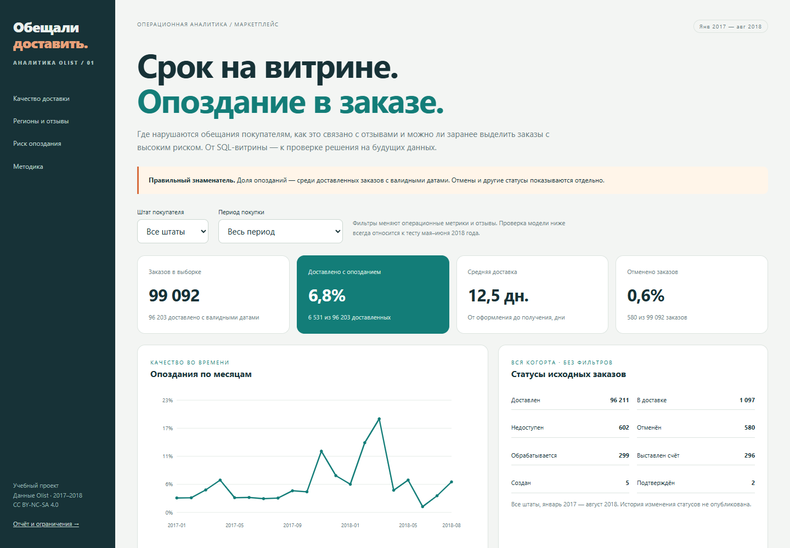

# Обещали доставить

**Почему заказы опаздывают и можно ли заметить риск ещё при оформлении?**

**[Открыть демо](https://vladislavsavin543.github.io/promise-delivery-lab/)** · [Отчёт](reports/REPORT_RU.md) · [Выполненный ноутбук](notebooks/01_delivery_analysis.ipynb) · [Вопросы по методике](INTERVIEW_RU.md)

Учебный проект по операционной аналитике на реальных данных Olist:
SQL-витрина из восьми таблиц, контроль качества доставки, связь с отзывами
и модель раннего риска с проверкой на будущих заказах.

## Ключевые результаты

- В основной когорте **99 092 заказа** января 2017 — августа 2018 года.
- Среди **96 203 доставленных с валидными датами** опоздали **6 531 — 6,79%**.
- На отдельном тесте модель выделяет **20% заказов** и находит
  **48,2% фактических опозданий**. Правило короткого обещанного срока находит **28,4%**.
- В приоритете модели опаздывают **9,65% заказов** при базовой частоте на тесте **4,00%**.
- Выбрана **логистическая регрессия** по average precision на валидации.
  На тесте **AP = 0,101**, **ROC-AUC = 0,743**.

**Граница вывода:** модель проверена среди доставленных заказов.
Будущий факт доставки при покупке неизвестен; поэтому это исследование ранжирования,
а не готовая система для всех новых заказов. Доступность обещанной даты, продавца
и каталога при оформлении требует подтверждения. Найти риск не означает предотвратить задержку.

## Состав анализа

| Задача | Реализация |
|---|---|
| SQL и модель данных | CTE, оконные функции, агрегация связей до заказа, сверка сумм |
| Качество данных | Уникальность ключей, внешние ключи, даты, дубли отзывов, неполные заказы |
| Бизнес-анализ | Сроки, отмены, регионы, категории, продавцы, низкие отзывы |
| Машинное обучение | Признаки на момент покупки, сравнение моделей и простого правила |
| Оценка модели | Проверка по времени с дозреванием исходов, AP, ROC-AUC, Brier, калибровка |
| Решение при ограниченном ресурсе | Точность и полнота при одинаковой доле заказов в приоритете |
| Результаты | Дашборд, отчёт и ноутбук с расчётами |

## Посмотреть без установки

Открой [онлайн-демо](https://vladislavsavin543.github.io/promise-delivery-lab/).
В нём можно выбрать штат и период, посмотреть отзывы и менять ресурс проверки
с 5% до 50%. Фильтры операционной части не меняют отдельную тестовую оценку модели.

Для локального просмотра скачай проект и открой reports/dashboard.html
или запусти open_dashboard.cmd в Windows. Интернет для готового дашборда не нужен.

## Воспроизвести

Рекомендуется **Python 3.12**. Из папки проекта:

~~~bash
python -m venv .venv
# Windows: .venv\Scripts\activate
# macOS/Linux: source .venv/bin/activate
python -m pip install -r requirements-dev.txt
python run.py
python scripts/build_notebook.py
python -m pytest -q
~~~

Первый запуск скачивает официальный архив Kaggle версии 2 и проверяет SHA-256
восьми используемых CSV. Геолокация на уровне почтовых индексов не нужна.
Исходные и обработанные клиентские данные исключены из репозитория и ZIP.
Готовые таблицы, графики, отчёт и выполненные ячейки доступны сразу.

## Что учитывается в расчётах

1. Доставка в обещанный день считается своевременной; полночь не становится
   искусственным крайним сроком.
2. Несколько товаров, оплат и отзывов не размножают деньги и заказы после JOIN.
3. Отменённые заказы не маскируются под своевременные доставки.
4. Для сравнения отзывов берётся последний ответ, не раньше фактической доставки.
5. Общая задержка многопродавцового заказа не приписывается одному продавцу.
6. Поток заказов за прошлые 7 дней не видит будущих покупок и исходов.
7. Модель сравнивается с постоянным риском и простым правилом при одном бюджете.
8. Связь задержек с отзывами рассматривается отдельно от причинного эффекта и финансовых последствий.

## Дизайн ML

Подбор: покупки января–октября 2017, исходы известны к январю 2018.
Валидация: январь–февраль 2018, исходы известны к маю.
Финальная модель обучается на доступном прошлом до марта 2018.
Тест: май–июнь 2018, **12 845 заказов и 514 опозданий**.
Решения сохраняются до тестовой оценки.

Частота опозданий меняется между периодами, поэтому AP разных периодов
нельзя сравнивать без учёта базовой частоты. Важна и калибровка, а не только ранжирование.
Подробности, интервалы и ограничения — в [методике](METHODOLOGY_RU.md) и отчёте.

## Структура

~~~text
run.py                         полный анализ
sql/01_order_mart.sql           витрина «один заказ — одна строка»
sql/02_monthly_metrics.sql      метрики доставки по месяцам
sql/03_seller_watchlist.sql     осторожный рейтинг продавцов
src/core.py                    сроки, прошлый поток заказов, признаки и бюджет
src/models.py                  Pipeline, метрики и парный bootstrap
src/reporting.py               русские графики, отчёт и дашборд
src/dashboard.html             шаблон автономного интерфейса
scripts/download_data.py       загрузка данных с проверкой SHA-256
scripts/build_notebook.py      выполненный разбор исследования
scripts/build_site.py          публикация демо без клиентских данных
tests/                         проверки JOIN, сроков, утечек, бюджета и результатов
reports/                       отчёт, дашборд, агрегаты и графики
notebooks/                     выполненный ноутбук
data/manifest.json             версия, источник и контрольные суммы данных
~~~

## Ограничения и следующий шаг

Это историческое наблюдательное исследование. Нет рандомизации задержек,
себестоимости, комиссий или истории изменения обещаний. Интервалы не учитывают
все зависимости заказов и переобучение. Источники ограничены доставленными
заказами и доступными датами.

Перед внедрением нужны подтверждение доступности признаков, новая полная когорта,
проверка отмен и незакрытых заказов, мониторинг калибровки.
Эффект обзвона или ускорения оценивается отдельным экспериментом.

## Данные и лицензии

[Olist Brazilian E-Commerce Public Dataset](https://www.kaggle.com/datasets/olistbr/brazilian-ecommerce),
версия 2, **CC BY-NC-SA 4.0**. Автор данных — Olist.
Код проекта — [MIT](LICENSE). Производные агрегаты, графики, отчёт и данные
дашборда — [CC BY-NC-SA 4.0](DATA_LICENSE.md), для некоммерческого использования
с атрибуцией Olist и сохранением лицензии.
Подробнее: [источники и словарь](DATA_SOURCES_RU.md).
