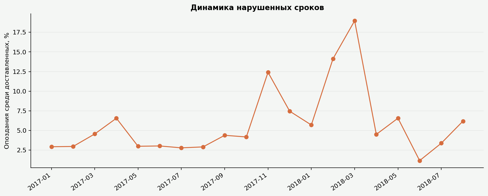
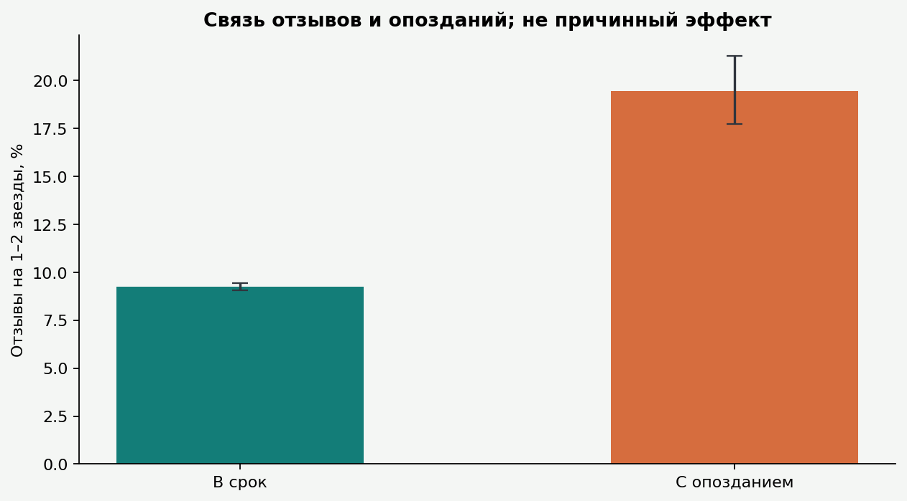
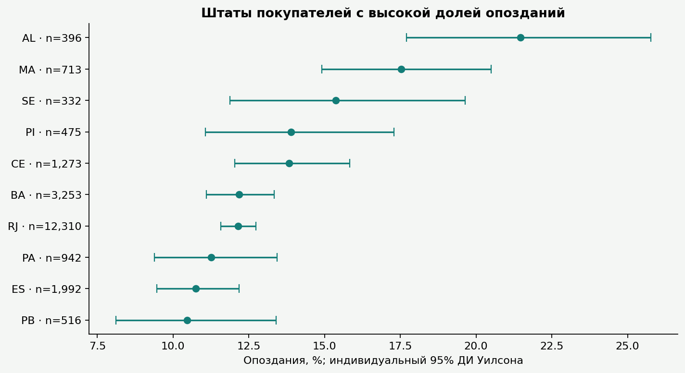
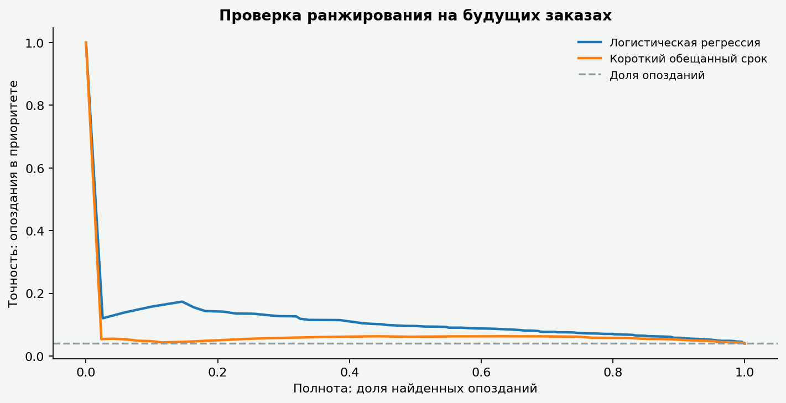
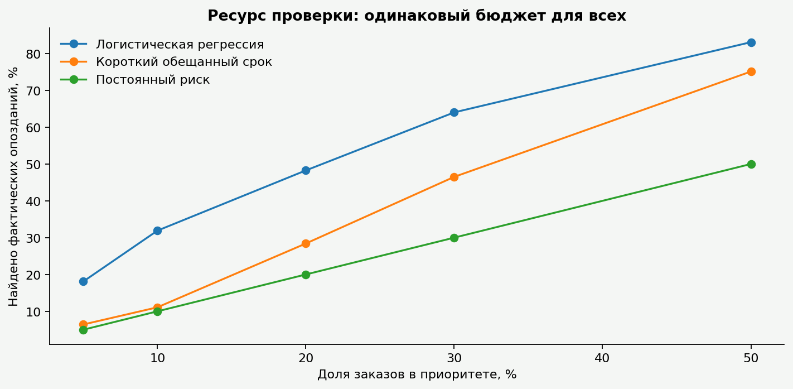
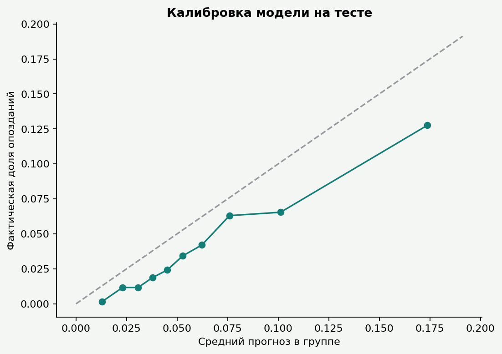

# Обещали доставить — результаты исследования

## Решение для бизнеса

Основная когорта: январь 2017 — август 2018, **99 092 заказов**.
Валидная фактическая доставка: **96 203**.
Из них **6 531 (6,8%)** доставлены позже обещанной календарной даты.

Отменено **580 (0,6%)** от всех заказов когорты.
Отмена не считается ни своевременной доставкой, ни доставленным опозданием.
Медиана доставки — 10.2 дня, 95-й процентиль — 29.2 дня.

На тесте модель при 20% бюджете превосходит правило короткого срока.
В 20% тестовых заказов с максимальным прогнозом найдены **48,2% опозданий**.
Точность приоритета — **9,7%**, доля опозданий на тесте — 4,0%.
Это качество ранжирования, а не доказательство пользы обзвона или изменения логистики.

## Границы применимости

Модель оценена **среди доставленных заказов**, а не среди всех будущих покупок.
Будущая доставка неизвестна при оформлении: для внедрения нужна проверка на всех новых заказах,
включая отмены и ещё не закрытые доставки.

Обещанная дата, цена доставки, продавцы и каталог предполагаются доступными при покупке.
Истории изменения этих полей в наборе нет. До подтверждения доступности признаков
в нужный момент модель нельзя считать готовой к эксплуатации.
Данные 2017–2018 годов не гарантируют качество на современном маркетплейсе.

## Как считаются сроки

Опоздание: DATE(фактическая доставка) > DATE(обещанная доставка).
Доставка в любое время обещанного дня своевременна: полночь в поле даты не является
реальным обещанием получить товар к 00:00.
Из доставленных заказов когорты исключено по качеству дат: 8.
Пустые и противоречивые даты не заменяются нулевым опозданием.

## Отзывы и опоздания

По заказу берётся последний ответ на отзыв; равные даты разрешаются стабильным порядком.
В сравнение входят только ответы не раньше доставки.
Повторных записей относительно order_id: 551.
Ответов до доставки исключено: 4648.

| Доставка | Отзывов | Оценки 1–2 | Средняя оценка |
|---|---:|---:|---:|
| В срок | 89005 | 9,2% | 4.29 |
| С опозданием | 1907 | 19,5% | 3.72 |

Это наблюдаемая связь, не причинный эффект. Различаются состав товаров, регионы,
ожидания, продавцы и те, кто оставил отзыв. Потерянная прибыль не оценивалась.

## Где разбирать процессы

Штаты с минимум 200 доставленными заказами, по наблюдаемой доле:

| Штат | Доставлено | Опоздания |
|---|---:|---:|
| AL | 396 | 21,5% |
| MA | 713 | 17,5% |
| SE | 332 | 15,4% |
| PI | 475 | 13,9% |
| CE | 1273 | 13,8% |
| BA | 3253 | 12,2% |
| RJ | 12310 | 12,1% |
| PA | 942 | 11,3% |

Категории с минимум 100 доставками. Для смешанных корзин берётся категория
с максимальной суммарной стоимостью, а не категория каждой позиции:

| Категория | Доставлено | Опоздания |
|---|---:|---:|
| audio | 342 | 12,0% |
| home_confort | 354 | 9,9% |
| fashion_underwear_beach | 117 | 9,4% |
| books_technical | 254 | 8,3% |
| Детские товары | 2748 | 8,2% |
| Офисная мебель | 1245 | 8,1% |
| christmas_supplies | 125 | 8,0% |
| Электроника | 2502 | 7,7% |

[Список продавцов для проверки](tables/seller_watchlist.csv) использует только заказы
с одним продавцом и минимум 100 доставками. Ранжирование — по нижней границе
индивидуального интервала Уилсона. Доля многопродавцовых заказов: 1,3%.
Рейтинг исследовательский: различия в составе заказов и множественные сравнения не устранены.
Общую задержку многопродавцового заказа не приписываем одному продавцу.

## Проверка модели по времени

- Подбор: покупки 2017-01-01 — 2017-10-31, доставка известна до 2018-01-01.
- Валидация: покупки 2018-01-01 — 2018-02-28, исходы известны до 2018-05-01.
- Финальное обучение: покупки до 2018-03-01, исходы до 2018-05-01.
- Тест: покупки 2018-05-01 — 2018-06-30, исходы до 2018-10-18.
- Между этапами оставлены периоды дозревания исходов. Доставки после границы
  исключаются, что дополнительно ограничивает оцениваемую совокупность.
- 2018-10-18 — техническая граница после последней записи; дата выгрузки статусов неизвестна.

| Выборка | Заказов | Опозданий |
|---|---:|---:|
| Подбор: обучение | 30621 | 1134 |
| Валидация | 13587 | 1292 |
| Финальное обучение | 57011 | 3743 |
| Тест | 12845 | 514 |

Кандидаты: логистическая регрессия и градиентный бустинг.
Выбор по average precision на валидации: **Логистическая регрессия**.
Пропуски и преобразования обучаются внутри Pipeline.
Решение сохранено в selection_lock.json до тестовой оценки.
Финальная модель обучается заново на доступном прошлом; тест не используется для подбора.

Признаки: срок обещания, корзина, цена и стоимость доставки, вес, объём, регионы,
категория, календарные признаки и прошлый поток заказов продавца за 7 дней.
Этот поток использует только покупки строго раньше текущего времени, без их исходов.
Заказы с равными временными метками не видят друг друга.
Фактические даты, статус, отзыв, shipping_limit_date и итоги оплаты исключены.

| Стратегия | AP | ROC-AUC | Точность @20% | Полнота @20% | Brier |
|---|---:|---:|---:|---:|---:|
| Постоянный риск | 0.040 | 0.500 | 4,0% | 20,0% | 0.0391 |
| Короткий обещанный срок | 0.057 | 0.649 | 5,7% | 28,4% | — |
| Логистическая регрессия | 0.101 | 0.743 | 9,7% | 48,2% | 0.0378 |

У рангового правила короткого срока нет вероятностной интерпретации — Brier не показывается.
Постоянный риск — частота опозданий финального обучения; случайный приоритет усреднён аналитически.
Бюджет равен floor(q × n); при равных прогнозах используется порядок анонимных order_id.

Разница полноты модели и правила при 20% бюджете: **+19.8 п.п.**
Парный bootstrap-интервал: **[+14.1; +26.4] п.п.**
300 повторов, seed=42. Он условен на обученных моделях и не учитывает переобучение
и зависимость заказов продавца во времени; это не гарантия на новый период.

Важность признаков вычислена перемешиванием на валидации, только для описания.
Важный предиктор не обязательно является причиной.

## Качество витрины

После всех JOIN — 99441 строк и столько же уникальных order_id.
Товары, отзывы и платежи предварительно агрегированы до одного заказа.
Суммы сверены с исходными таблицами: товары 13591643.70,
доставка 2251909.54,
платежи 16008872.12 BRL.
Эти суммы не означают чистую выручку или прибыль.
Заказов без товарных строк: 775.
Проверены уникальность справочников, внешние ключи и неотрицательные суммы.

## Следующий шаг

Разобрать причины задержек в крупных проблемных сегментах.
Подтвердить доступность признаков при покупке и проверить модель на новой полной когорте.
Пользу обзвона или ускорения оценивать отдельным контролируемым экспериментом.

## Источник

Olist, Brazilian E-Commerce Public Dataset, версия 2:
[официальная страница](https://www.kaggle.com/datasets/olistbr/brazilian-ecommerce).
Данные и производные отчёты, графики, агрегаты — CC BY-NC-SA 4.0, атрибуция Olist.
Код проекта — MIT. Клиентские выгрузки исключены из сайта, Git и архива.

[Дашборд](dashboard.html) · [Словарь таблиц](tables/README_RU.md) · [Методика](../METHODOLOGY_RU.md)
